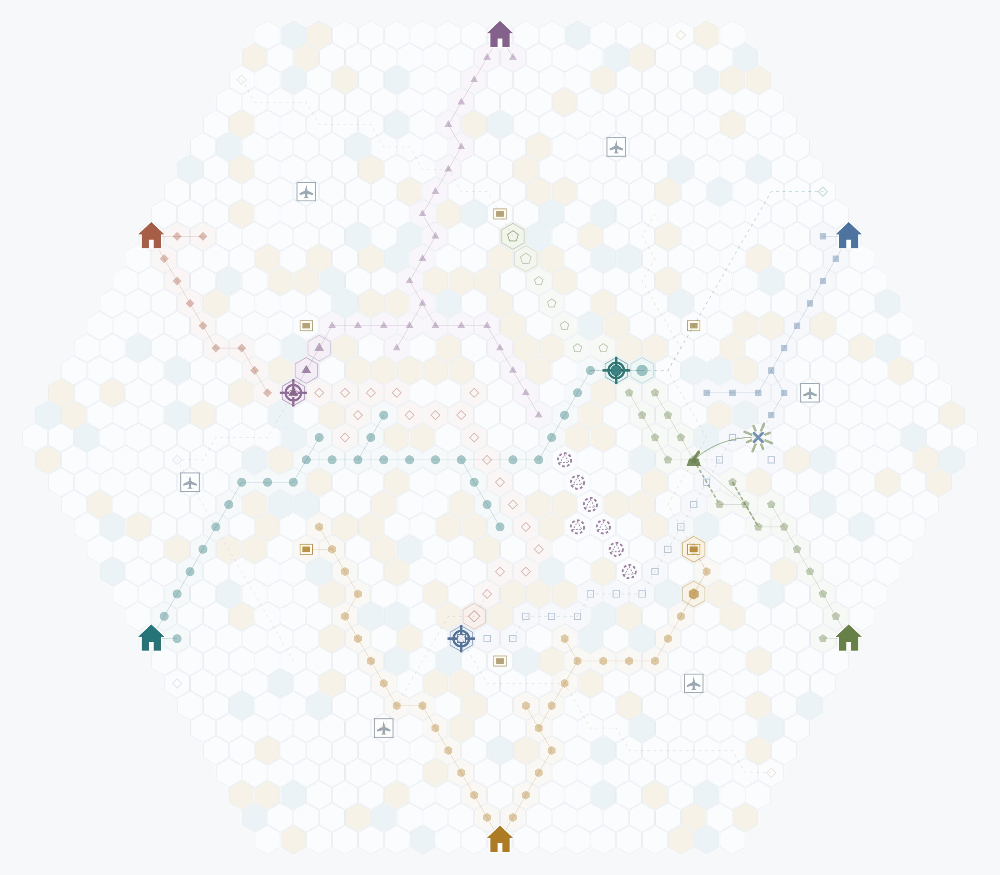

# AutoHex 戰局截圖

按「截圖」會立即暫停戰役，把最近 18 個回合（18 次行動，約六方各 3 次）的變化全部壓在一張地圖上，匯出成 PNG。預覽視窗可以下載，手機長按也能儲存。

## 地圖上的呈現（只有地圖，沒有文字、表格或圖例）

- 時間用深淺表示：越新的變化越深，18 回合前的最淡。
- 擴張：視窗內新落下的棋子畫得較大、顏色較深，外圍有一圈陣營色的六角框；在那之前就持有的地盤則淡化成底色。
- 失地：已經消失的棋子留一個陣營色的虛線空心殘影。
- 砲台砲擊畫實線弧、航空轟炸畫虛線弧，命中處是爆裂星芒，被護盾擋下則是盾牌。被消滅的棋子標成 ×（失子方的顏色），攻占是準星，斷補撤退是虛線圈，空投是砲台圖示。
- AI 策略是極淡的細虛線，目標用小空心菱形；物資站改畫成方形箱，不會跟策略目標混淆。
- 接通對岸、停戰、背盟、機場啟用這幾類事件，以小圖示標在該陣營的家園旁邊。
- 只含公開資訊，不含任何手牌。

## 紀錄方式

核心只保留最近 96 筆事件，所以 UI 每次 render 都把新事件、各格易主的時間點和公開策略記進 `AutoHexSnapshot.Chronicle`，約留 24 個回合。開新戰場或重播時會清空紀錄。

## 驗證

- `node --test tests/*.test.cjs` 全數通過。新增的 `tests/autohex-snapshot.test.cjs` 涵蓋：視窗是 18 個行動而非 18 輪、擴張與失地殘影、砲擊／護盾／消滅的歸屬、策略去重，以及整張圖完全沒有任何文字繪製呼叫。
- `node tests/autohex-snapshot-browser.cjs`（需要本機 HTTP 和 Playwright）：分別在桌面和手機寬度觀戰 40 輪後截圖，確認狀態變為暫停、視窗開著時棋局不會前進、下載的檔案是 PNG，而且頁面沒有錯誤。
