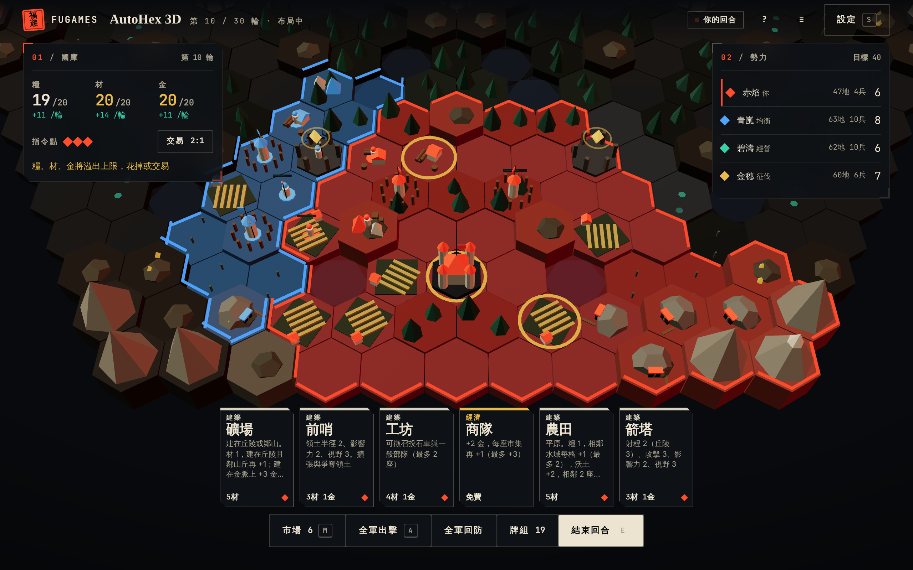
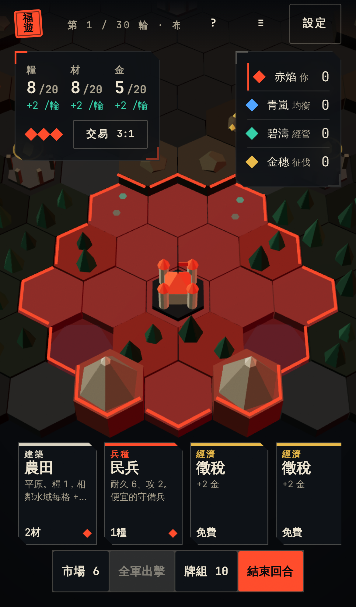

# HexBattle：設計與驗證

## 為什麼重做

舊版 AutoHex-3D 是 AutoHex 規則核心外面套一層 3D 畫面。它的地形只影響通行，資源只有一種，抽牌也幾乎沒有取捨，所以對 agent 對戰場來說可以做的決策太少。新版換成一套專門的引擎，每一輪都要在三件事之間做選擇：

1. **牌組構築**
   - 起手 10 張牌，從 6 格共用市場用金幣買牌。買到的牌要等洗牌後才會抽到。
   - 「整編」可以把弱牌永久移除。
   - 功勳牌放在牌組裡就算分，但抽到時是廢牌。所以要決定什麼時候從發展轉去拿分。
   - 市場最左邊的牌每輪會被移除，你沒買的好牌可能被別人買走或直接消失。
2. **布局**
   - 每座建築的產量取決於鄰居：農田要靠水、靠沃土、連成一片；伐木場要靠森林；礦場要靠丘陵和金脈；市集要被己方建築圍住。
   - 領土是影響力的拉鋸。前哨可以把邊界推出去，但每類建築蓋越多就越貴。
   - 領土要連回都城，被切斷的建築不生產。
3. **經營**
   - 有糧、材、金三種資源，各有上限。
   - 糧先餵部隊，再餵建築工人。軍隊越大，經濟就越容易因為缺糧而停擺。
   - 多出來的資源可以和銀行 3 換 1（有市集時 2 換 1），也可以花在升級上。
   - 都城升級可以增加手牌上限和指令點。

戰鬥在所有人結束布局後同時自動進行，所以沒有人能在別人行動後再反應。

可以反制對手的手段有：
- 兵種相剋。
- 用地形取得掩護與射程。
- 在己方領土埋伏兵。
- 用火箭與破壞癱瘓對方的關鍵建築。
- 劫掠對方的金幣。
- 用前哨搶影響力。
- 站在對方的遺跡旁邊，讓它不能計分。

## 公平性

- 地圖是完整的六角對稱（6 個旋轉加 6 個鏡射，共 12 種）。每個都城到中央的距離相同，到最近遺跡的距離也相同。
- 行動順序是蛇形輪替，每兩輪換一次，偶數輪反向。
- 所有平手判定都用雜湊決定，而不是用格子編號，所以不會偏向某個方向。

測試 `tests/hexbattle-engine.test.cjs` 會檢查：
- 2 到 6 方的地圖都對稱。
- 每個都城都走得到中央和所有遺跡。
- 重播結果確定（包含中途存成 JSON 再續玩）。
- 隨機合法動作不會被拒絕。
- 迷霧不會洩漏資訊。
- CLI 與對戰場可以正常運作。

## 內建 AI 互打（`node tools/hexbattle-sim.cjs --games 40 --players 4 --seed doc`）

| 指標 | 結果 |
| --- | --- |
| 平均局長 | 18 輪（最短 12，最長 25），40 局全部以達到目標分數結束 |
| 席位勝場 | 1 號 12 / 2 號 8 / 3 號 9 / 4 號 11 |
| 打法勝場 | 堅守 17、劫掠 7、均衡 6、經營 5、征伐 5 |
| 每方每局 | 約 30–40 座建築、20 次擊殺，常有建築被摧毀 |

**已知問題：**
- 「堅守」打法偏強。它把遺跡守住的效率最好。
- 「經營」與「征伐」偏弱。

下一輪調整可以用 `--profiles` 做單一打法對照，再改 AI 權重或遺跡計分。這不影響規則本身的正確性。

## 介面

- 介面使用共用的朱墨設計系統（`shared/fu.css`、`shared/fu-three.js`），畫面是滿版的 three.js 戰場。
- 常駐的只有國庫、勢力、手牌與指令列。市場、牌組、戰報、規則和設定都收在抽屜裡。
- 設定包含模式、勢力數、種子、回合上限、AI 打法、中立守軍、播放速度、邊界、血條和全知觀戰。
- 選一張建築牌時，地圖會標出所有合法位置。滑鼠移到格子上，會顯示在那裡建造後每輪淨產量和領土的變化。
- 舊版即時指揮版保留在 `autohex_3d_classic.html`，可從典藏頁進入。
