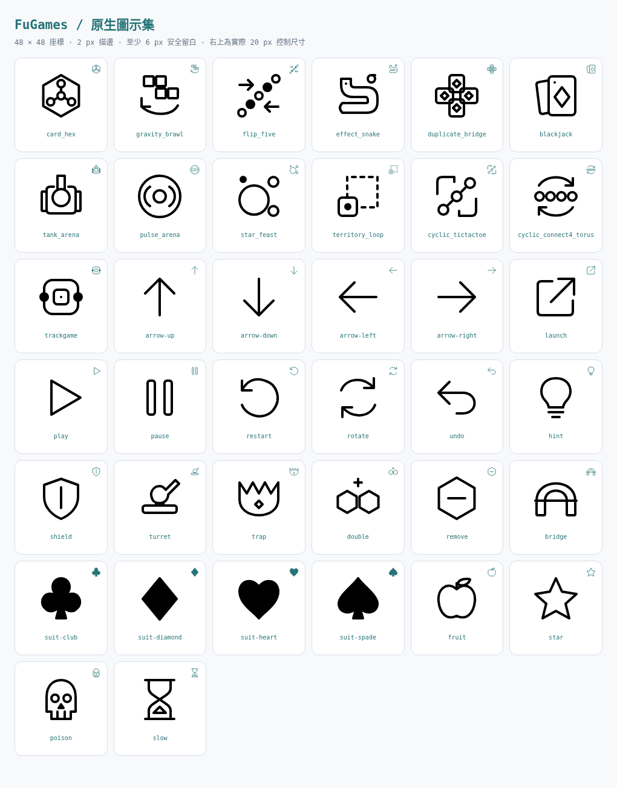

# 修改前後畫面比對

初始畫面先於修改擷取：基線 `5711ea87c1cdf9537cb5b045a2f520a0833d6d26`。之後以相同固定種子、Chromium、桌機 1366×1000／手機 390×844 重拍。以下保存每頁開局後原始全頁 PNG；開局前與後的完整 112 張原始畫面仍在執行環境 `/tmp/fugames-revision-visual/`。

每個連結皆為實際瀏覽器截圖。首頁沒有開局動作；三款早期棋盤的相同走棋狀態另在下方提供。

| 頁面 | 主要改動 | 桌機前／後 | 手機前／後 |
| --- | --- | --- | --- |
| 首頁 | 13 個圖示統一幾何、留白與分類淡底，入口箭頭使用 SVG。 | [前](screenshots/before/index-desktop.png) / [後](screenshots/after/index-desktop.png) | [前](screenshots/before/index-mobile.png) / [後](screenshots/after/index-mobile.png) |
| 三子循環棋 | 黑白幾何棋子、移動順序 1／2、雙框勝線。 | [前](screenshots/before/cyclic_tictactoe-desktop.png) / [後](screenshots/after/cyclic_tictactoe-desktop.png) | [前](screenshots/before/cyclic_tictactoe-mobile.png) / [後](screenshots/after/cyclic_tictactoe-mobile.png) |
| 環面直落四子 | 等比例圓孔、SVG 落子箭頭、環面虛邊與最新落子標記。 | [前](screenshots/before/cyclic_connect4_torus-desktop.png) / [後](screenshots/after/cyclic_connect4_torus-desktop.png) | [前](screenshots/before/cyclic_connect4_torus-mobile.png) / [後](screenshots/after/cyclic_connect4_torus-mobile.png) |
| 軌道棋 | 幾何棋子置中，內外圈線型、菱形提示及一致控制鈕。 | [前](screenshots/before/trackgame-desktop.png) / [後](screenshots/after/trackgame-desktop.png) | [前](screenshots/before/trackgame-mobile.png) / [後](screenshots/after/trackgame-mobile.png) |
| 抽牌 Hex | 91 格正六邊形、三方形狀與對邊線型、道具圖示及可放大棋盤。 | [前](screenshots/before/card_hex-desktop.png) / [後](screenshots/after/card_hex-desktop.png) | [前](screenshots/before/card_hex-mobile.png) / [後](screenshots/after/card_hex-mobile.png) |
| 重力大亂鬥 | SVG 方向、比例一致的方塊預覽、落點虛框與干擾斜線。 | [前](screenshots/before/gravity_brawl-desktop.png) / [後](screenshots/after/gravity_brawl-desktop.png) | [前](screenshots/before/gravity_brawl-mobile.png) / [後](screenshots/after/gravity_brawl-mobile.png) |
| 翻轉五子棋 | 圓環／菱形芯、翻面虛框、五連雙框。 | [前](screenshots/before/flip_five-desktop.png) / [後](screenshots/after/flip_five-desktop.png) | [前](screenshots/before/flip_five-mobile.png) / [後](screenshots/after/flip_five-mobile.png) |
| 效果貪食蛇 | Canvas 幾何食物與 SVG 圖例對應，方向鈕與效果狀態一致。 | [前](screenshots/before/effect_snake-desktop.png) / [後](screenshots/after/effect_snake-desktop.png) | [前](screenshots/before/effect_snake-mobile.png) / [後](screenshots/after/effect_snake-mobile.png) |
| 複式橋牌 | SVG 花色、合法牌底線、建議虛框與文字標籤。 | [前](screenshots/before/duplicate_bridge-desktop.png) / [後](screenshots/after/duplicate_bridge-desktop.png) | [前](screenshots/before/duplicate_bridge-mobile.png) / [後](screenshots/after/duplicate_bridge-mobile.png) |
| 經典 21 點 | SVG 花色、幾何牌背、輪到的 AI 座位雙框。 | [前](screenshots/before/blackjack-desktop.png) / [後](screenshots/after/blackjack-desktop.png) | [前](screenshots/before/blackjack-mobile.png) / [後](screenshots/after/blackjack-mobile.png) |
| 鋼芯競技場 | 對稱坦克圖示、分格裝甲、靶標裂痕與重生框線。 | [前](screenshots/before/tank_arena-desktop.png) / [後](screenshots/after/tank_arena-desktop.png) | [前](screenshots/before/tank_arena-mobile.png) / [後](screenshots/after/tank_arena-mobile.png) |
| 脈衝擂台 | 擂台外斜線、邊緣括弧、SVG 蓄力及可及進度。 | [前](screenshots/before/pulse_arena-desktop.png) / [後](screenshots/after/pulse_arena-desktop.png) | [前](screenshots/before/pulse_arena-mobile.png) / [後](screenshots/after/pulse_arena-mobile.png) |
| 圈地漫遊 | 陣營形狀、首領／助手／基地原生幾何、AI 標籤。 | [前](screenshots/before/territory_loop-desktop.png) / [後](screenshots/after/territory_loop-desktop.png) | [前](screenshots/before/territory_loop-mobile.png) / [後](screenshots/after/territory_loop-mobile.png) |
| 星點吞噬 | 可吞實框、威脅虛框／三角、星形大光點。 | [前](screenshots/before/star_feast-desktop.png) / [後](screenshots/after/star_feast-desktop.png) | [前](screenshots/before/star_feast-mobile.png) / [後](screenshots/after/star_feast-mobile.png) |

## 早期棋盤：相同走棋狀態

這六組額外配對把同一個已走棋局分別呈現在基線與新版，便於比較實際棋子、提示與勝線。Before 由上述基線 commit 的隔離副本重新擷取，逐檔核對 Git 原文，並非目前頁面的模擬舊樣式。兩版棋局狀態完全相同；[來源與操作紀錄](screenshots/classic-state/source-metadata.json) 保存各檔 hash、fixture 與尺寸。

| 遊戲 | 桌機前／後 | 手機前／後 |
| --- | --- | --- |
| 三子循環棋 | [前](screenshots/classic-state/before-cyclic_tictactoe-desktop.png) / [後](screenshots/classic-state/after-cyclic_tictactoe-desktop.png) | [前](screenshots/classic-state/before-cyclic_tictactoe-mobile.png) / [後](screenshots/classic-state/after-cyclic_tictactoe-mobile.png) |
| 環面直落四子 | [前](screenshots/classic-state/before-cyclic_connect4_torus-desktop.png) / [後](screenshots/classic-state/after-cyclic_connect4_torus-desktop.png) | [前](screenshots/classic-state/before-cyclic_connect4_torus-mobile.png) / [後](screenshots/classic-state/after-cyclic_connect4_torus-mobile.png) |
| 軌道棋 | [前](screenshots/classic-state/before-trackgame-desktop.png) / [後](screenshots/classic-state/after-trackgame-desktop.png) | [前](screenshots/classic-state/before-trackgame-mobile.png) / [後](screenshots/classic-state/after-trackgame-mobile.png) |

## Hex 特殊規則的實際畫面

[己方秘密區域](screenshots/hex-states/own-trap-zone.png)、[陷阱觸發揭露](screenshots/hex-states/trap-revealed.png)、[公開射程與倒數](screenshots/hex-states/turret-warning.png)、[炮台到期解除](screenshots/hex-states/turret-expired.png)、[飛橋連線獲勝](screenshots/hex-states/bridge-win.png)、[完整手機局結算](screenshots/hex-states/mobile-complete.png)。以上使用最終頁面實際操作／明確規則 fixture，另有完整手機對局自然玩到結算。

## 圖示與檢查

[實際 SVG 量測](icons-measurements.json)、[修改前畫面清單](screenshots/before/inventory.json)、[修改後畫面清單](screenshots/after/inventory.json)。修改後 28 組頁面／尺寸無橫向溢出、console error、pageerror 或失敗請求。另有 320px 窄屏及 844×390 橫屏的獨立檢查，詳見 [驗證](validation.md)。

主整合與各視覺工作者已目視桌機／手機配對：圖示等比且置中，棋子輪廓不依賴字型；可操作、提示、危險及勝利狀態有形狀／線型／文字輔助。這些是 Chromium 模擬尺寸，未宣稱實體手機或其他瀏覽器已驗證。
